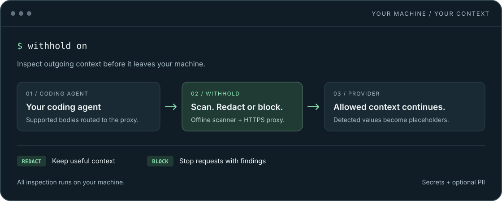

<div align="center">


# withhold

**Catch secrets before they become AI context.**

Local secret redaction for coding agents. Offline scanning. One Go binary.

[](https://github.com/cquark7/withhold/actions/workflows/verify.yml)
[](https://github.com/cquark7/withhold/releases/latest)
[](LICENSE)
[](CONTRIBUTING.md#development-setup)

[Install](#install) · [Try it](#try-it-locally) · [Connect Copilot](#connect-vs-code--copilot) · [Docs](docs/README.md) · [Contribute](#contribute)

</div>

Coding agents send context beyond the text you type: file contents, tool results,
and examples can contain credentials. withhold inspects supported outgoing
request bodies on your machine and replaces detected values or blocks the request
before forwarding it to the provider.

<p align="center">
  
</p>

**Works with desktop VS Code + GitHub Copilot.** See the
[integration guide](docs/integrations/vscode-copilot.md) for setup and platform
requirements. Want another coding agent? [Help build an integration](#contribute).

## Why withhold

- **Local inspection.** Secret detection and optional PII scanning run offline.
  There is no project telemetry, remote scanner, or cloud scanning account.
- **Useful context can continue.** Chat redacts detected values by default;
  inline completions block findings so placeholders do not end up in code.
- **A small runtime.** The executable bundles the proxy and scanner. Installed
  users need neither Python nor a separate detector process to manage.
- **Reversible setup.** Managed editor settings are backed up; `withhold off`
  restores them while preserving unrelated edits.
- **Explicit integrations.** Each supported harness has a documented traffic
  contract, recovery behavior, and validation matrix.

## Install

### macOS and Linux

Install [GitHub CLI](https://cli.github.com/) for release provenance verification,
then run:

```sh
curl -fsSL https://github.com/cquark7/withhold/releases/latest/download/install.sh | sh
export PATH="$HOME/.local/bin:$PATH"
```

The installer selects your OS and CPU, verifies the binary's provenance and
checksum, and installs to `~/.local/bin`. No sudo, Go, or Python is needed.
See the [installation guide](docs/usage.md#installation) to review the script,
pin a version, or choose another directory.

### Windows

Download the x64 or ARM64 archive from
[Releases](https://github.com/cquark7/withhold/releases/latest), follow the
[verification steps](docs/usage.md#windows-and-manual-downloads), then run
`.\withhold.exe install`. Add the printed directory to your user PATH.

Prefer to compile it yourself? See [building from source](docs/usage.md#build-from-source).

## Try it locally

```sh
withhold demo
```

The demo sends a synthetic value through the bundled scanner and HTTPS proxy to
a temporary local receiver. It verifies the redacted bytes and checks that a
blocked request never reaches that receiver. No Copilot account, editor setup,
or system trust changes are needed. It does not verify real editor routing.

## Connect VS Code + Copilot

Start with a working Copilot account. **Setup creates a local HTTPS inspection
CA and changes current-user certificate trust on macOS/Linux.** Windows uses
manual trust. Linux NSS trust may not cover Node-based extensions. Review
[certificate trust](docs/usage.md#certificate-trust) and the
[integration guide](docs/integrations/vscode-copilot.md) first.

```sh
withhold setup
withhold doctor
withhold on --integration vscode-copilot
# Open VS Code normally; restart it once after initial CA setup.
withhold status
```

The configured VS Code installation shares these settings across its local
workspaces and profiles. Check status and audit surfaces for inspection evidence;
a running proxy alone does not prove the editor is routing supported traffic.

```sh
withhold off       # Stop the session and restore managed settings.
```

See [recovery and removal](docs/usage.md#recovery-and-removal) for interrupted
sessions and CA cleanup. withhold does not restart automatically at login/reboot.

## What it inspects

| Surface | Default behavior |
| --- | --- |
| Chat | Redact detected secrets, then forward. |
| Inline completions | Block requests containing findings. |
| Embeddings | Attempt redaction; inspection-policy failures pass through unscanned. |
| Optional PII | Email, phone, payment card, US SSN, IP address, and Aadhaar; off by default. |

The scanner walks eligible JSON strings and keys, tool text, and decoded base64
text. HTTP/HTTPS, HTTP/2, compressed request bodies, and JSON WebSocket messages
are supported. Secret detection uses bundled
[betterleaks](https://github.com/betterleaks/betterleaks) rules; optional PII uses
selected [Alcatraz](https://github.com/hoophq/alcatraz) recognizers.

Detected values become markers such as `<WITHHELD_0123456789abcdef>`.
The same value and local key produce the same marker; values are never restored
in responses. Stable markers can reveal repeated values.

Stop an existing session before changing its options:

```sh
withhold on --pii email,phone      # Enable selected PII categories.
withhold on --chat-mode block     # Block chat findings instead of redacting.
```

Use `withhold config --example` for a commented TOML starter or read the
[configuration reference](docs/configuration.md).

## Privacy and limits

- Inspection covers supported bodies **routed through the proxy**. Deliberate
  bypass, integration-specific passthrough, and unrelated hosts are outside it.
- Headers, URL queries, responses, and opaque media/document/archive attachments
  are not scanned. There is no OCR or document extraction.
- Detection can miss values or produce false positives. PII patterns are not
  identity checks. See the [behavior contract](CONTRACTS.md).
- **Observe mode forwards sensitive content unchanged.** Debug mode writes masked
  finding prefixes to a private log; use it temporarily and do not share it.
- Allowed requests still reach the provider. Local CA keys, session records,
  settings backups, and logs are sensitive.

## Contribute

Help make local privacy a part of everyday coding. Contributions are welcome:
new integrations, detection cases, clearer docs, and focused fixes.

| You can help with | Start here |
| --- | --- |
| A setup problem or a synthetic detection case | [Report a bug](https://github.com/cquark7/withhold/issues/new?template=bug_report.yml). |
| Clearer onboarding, examples, or recovery steps | [Contribution guide](CONTRIBUTING.md#your-first-contribution). |
| Another coding agent | [Propose an integration](https://github.com/cquark7/withhold/issues/new?template=integration_request.yml), then read [the adapter guide](docs/adding-integrations.md). |
| A vulnerability | [Report privately](SECURITY.md); keep exploit details out of public issues. |

[Good first issues](https://github.com/cquark7/withhold/issues?q=is%3Aissue%20is%3Aopen%20label%3A%22good%20first%20issue%22)
· [Help wanted](https://github.com/cquark7/withhold/issues?q=is%3Aissue%20is%3Aopen%20label%3A%22help%20wanted%22)
· [Support](SUPPORT.md) · [Community guidelines](CODE_OF_CONDUCT.md)

## Documentation

- [Usage and recovery](docs/usage.md) · [Integration catalog](docs/integrations/README.md)
- [Configuration](docs/configuration.md) · [Protection contract](CONTRACTS.md)
- [Architecture](docs/architecture.md) · [Adding an integration](docs/adding-integrations.md)
- [Development](CONTRIBUTING.md) · [Release verification](docs/releasing.md)

## License

[MIT](LICENSE). Binary archives include third-party license notices.
Independent project, unaffiliated with GitHub or Microsoft.
