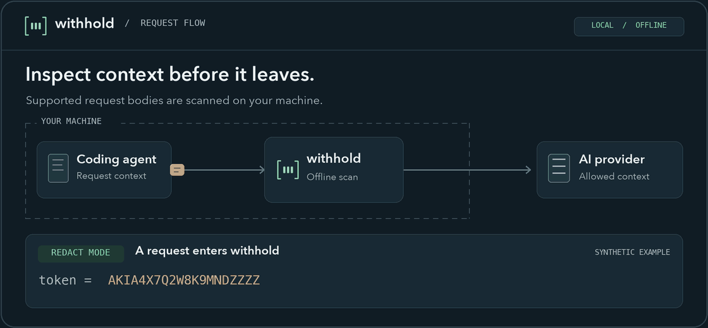

<div align="center">


# withhold

**Catch secrets and personal information before they reach your AI assistant.**

Local secret redaction for coding agents. Offline scanning. One Go binary.

[](https://github.com/cquark7/withhold/actions/workflows/verify.yml)
[](https://github.com/cquark7/withhold/releases/latest)
[](LICENSE)
[](CONTRIBUTING.md#development-setup)

[Install](#install) · [Try it](#try-it-locally) · [Connect Copilot](#connect-github-copilot-for-vs-code) · [Docs](docs/README.md) · [Contribute](#contribute)

</div>

Coding agents send context beyond the text you type: file contents, tool results,
and examples can contain credentials. <span style="color:#10b981; font-weight:bold;">withhold</span> inspects supported outgoing request bodies on your machine and replaces detected values or blocks the request
before forwarding it to the provider.

<p align="center">
  
  <br>
</p>

**Works with desktop VS Code + GitHub Copilot.** See the
[integration guide](docs/integrations/vscode-copilot.md) for setup and platform
requirements. Want another coding agent? [Help build an integration](#contribute).

## Why withhold

- **Local inspection.** Secret detection and optional PII scanning run offline.
  There is no project telemetry, remote scanner, or cloud scanning account.
- **Useful context can continue.** Chat redacts detected values by default;
  inline completions block findings so placeholders do not end up in code.
- **A small runtime.** The executable bundles the proxy and scanner. Installed
  users need neither Python nor a separate detector process to manage.
- **Reversible setup.** Managed editor settings are backed up; `withhold off`
  restores them while preserving unrelated edits.

## Install

### macOS and Linux

```sh
curl -fsSL https://github.com/cquark7/withhold/releases/latest/download/install.sh | sh
export PATH="$HOME/.local/bin:$PATH"
```

Add the `export` line to your shell profile to keep withhold on your PATH in new terminals. For a specific version or to review the installer first, see the [installation guide](docs/usage.md#installation).

### Windows

Download the Windows ZIP for your processor from [Releases](https://github.com/cquark7/withhold/releases/latest)
(`windows-amd64` for x64 or `windows-arm64` for ARM64). Extract it, then open
PowerShell in the extracted folder and run:

```powershell
.\withhold.exe install
```

Add the printed directory (normally `%LOCALAPPDATA%\withhold\bin`) to your
user PATH, then open a new terminal. Keep the included license and notice files.
For checksum and signed provenance verification, see the
[Windows guide](docs/usage.md#windows-and-manual-downloads).

### Install with Go

With [Go](https://go.dev/dl/) 1.26 or later installed, run:

```sh
go install github.com/cquark7/withhold/cmd/withhold@latest
```

Make sure Go's binary directory is on your PATH: `GOBIN` if set, otherwise
`GOPATH/bin` (normally `~/go/bin`, or `%USERPROFILE%\go\bin` on Windows).
To create a configuration file, run `withhold config --init`.

### Build from source

Install [Go](https://go.dev/dl/) 1.26 or later and Git, then run:

```sh
git clone https://github.com/cquark7/withhold.git
cd withhold
go build -trimpath -o withhold ./cmd/withhold
./withhold install
export PATH="$HOME/.local/bin:$PATH"
```

On Windows PowerShell, run `go build -trimpath -o withhold.exe ./cmd/withhold`
and `.\withhold.exe install` after cloning. Add the printed directory to your
user PATH. Installation creates a default configuration if one does not exist.

## Try it locally

Scan local files or directories without setup:

```sh
withhold scan .env
withhold scan . --pii email,phone
```

Findings show rules and locations, never values; scanning does not change files.
Hidden and Git-ignored text is included, while common dependency/generated paths
are skipped by default. See
[local scanning](docs/usage.md#scan-local-text) for stdin/text input, exclusions,
PII-only scans, JSON output, and incomplete-scan limits.

## Connect Github Copilot for VS Code

Setup creates a local certificate authority
(CA) so VS Code can trust withhold to inspect encrypted requests before they are
sent. **Setup changes current-user certificate trust on macOS/Linux.** Windows
uses manual trust. Review
[certificate trust](docs/usage.md#certificate-trust) and the
[integration guide](docs/integrations/vscode-copilot.md) first.

```sh
withhold setup
withhold doctor
withhold on --integration vscode-copilot
# Open VS Code normally; restart it once after initial CA setup.
withhold status
```

The configured VS Code installation shares these settings across its local
workspaces and profiles. Check status and audit surfaces for inspection evidence;
a running proxy alone does not prove the editor is routing supported traffic.

```sh
withhold off       # Stop the session and restore managed settings.
```

See [recovery and removal](docs/usage.md#recovery-and-removal) for interrupted
sessions and CA cleanup. withhold does not restart automatically at login/reboot.

## What it inspects

| Surface            | Default behavior                                                             |
| ------------------ | ---------------------------------------------------------------------------- |
| Chat               | Redact detected secrets, then forward.                                       |
| Inline completions | Block requests containing findings.                                          |
| Embeddings         | Attempt redaction; inspection-policy failures pass through unscanned.        |
| Optional PII       | Email, phone, payment card, US SSN, IP address, and Aadhaar; off by default. |

The scanner walks eligible JSON strings and keys, tool text, and decoded base64
text. HTTP/HTTPS, HTTP/2, compressed request bodies, and JSON WebSocket messages
are supported. Secret detection uses bundled
[betterleaks](https://github.com/betterleaks/betterleaks) rules; optional PII uses
selected [Alcatraz](https://github.com/hoophq/alcatraz) recognizers.

Detected values become markers such as `<WITHHELD_0123456789abcdef>`.
The same value and local key produce the same marker; values are never restored
in responses. Stable markers can reveal repeated values.

Personal information detection is off by default. To detect email addresses and
phone numbers, stop the current session and start it with PII enabled:

```sh
withhold off
withhold on --pii email,phone
```

Chat requests redact detected values; inline completions with findings are
blocked. To block chat requests as well, add `--chat-mode block`.

Edit `~/.config/withhold/config.toml` to persist settings, and run
`withhold config` to see the effective configuration. For an existing
installation without a config file, `withhold config --init` creates one without
overwriting anything. See the [configuration reference](docs/configuration.md).

## Privacy and limits

- Inspection covers supported bodies **routed through the proxy**. Deliberate
  bypass, integration-specific passthrough, and unrelated hosts are outside it.
- Headers, URL queries, responses, and opaque media/document/archive attachments
  are not scanned. There is no OCR or document extraction.
- Detection can miss values or produce false positives. PII patterns are not
  identity checks. See the [behavior contract](CONTRACTS.md).
- **Observe mode forwards sensitive content unchanged.** Debug mode writes masked
  finding prefixes to a private log; use it temporarily and do not share it.
- Allowed requests still reach the provider. Local CA keys, session records,
  settings backups, and logs are sensitive.

## Contribute

Help make local privacy a part of everyday coding. Contributions are welcome:
new integrations, detection cases, clearer docs, and focused fixes.

| You can help with                               | Start here                                                                                                                                                             |
| ----------------------------------------------- | ---------------------------------------------------------------------------------------------------------------------------------------------------------------------- |
| A setup problem or a synthetic detection case   | [Report a bug](https://github.com/cquark7/withhold/issues/new?template=bug_report.yml).                                                                                |
| Clearer onboarding, examples, or recovery steps | [Contribution guide](CONTRIBUTING.md#your-first-contribution).                                                                                                         |
| Another coding agent                            | [Propose an integration](https://github.com/cquark7/withhold/issues/new?template=integration_request.yml), then read [the adapter guide](docs/adding-integrations.md). |
| A vulnerability                                 | [Report privately](SECURITY.md); keep exploit details out of public issues.                                                                                            |

[Good first issues](https://github.com/cquark7/withhold/issues?q=is%3Aissue%20is%3Aopen%20label%3A%22good%20first%20issue%22)
· [Help wanted](https://github.com/cquark7/withhold/issues?q=is%3Aissue%20is%3Aopen%20label%3A%22help%20wanted%22)
· [Support](SUPPORT.md) · [Community guidelines](CODE_OF_CONDUCT.md)

## Documentation

- [Usage and recovery](docs/usage.md) · [Integration catalog](docs/integrations/README.md)
- [Configuration](docs/configuration.md) · [Protection contract](CONTRACTS.md)
- [Architecture](docs/architecture.md) · [Adding an integration](docs/adding-integrations.md)
- [Development](CONTRIBUTING.md) · [Release verification](docs/releasing.md)

## License

[MIT](LICENSE). Releases include third-party license notices for each binary.
Independent project, unaffiliated with GitHub or Microsoft.
